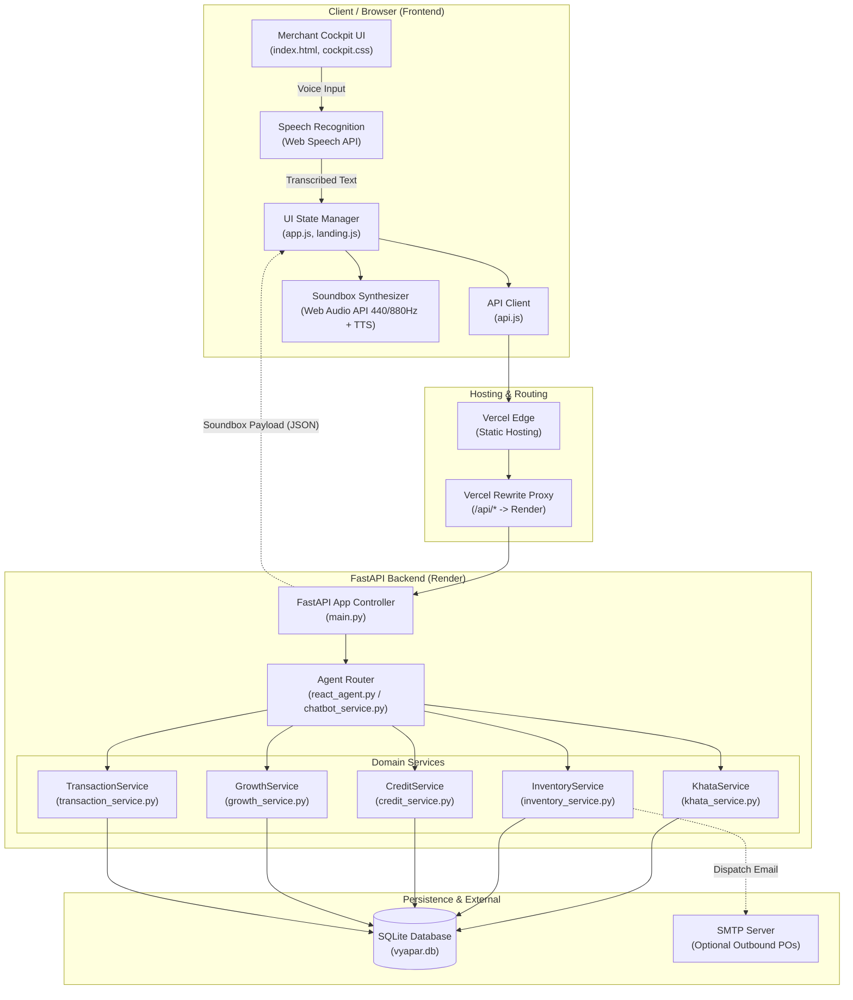
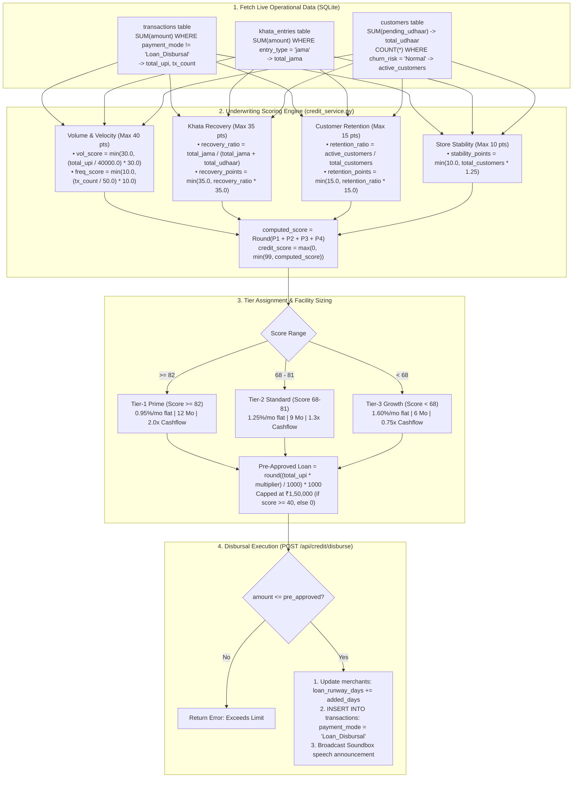
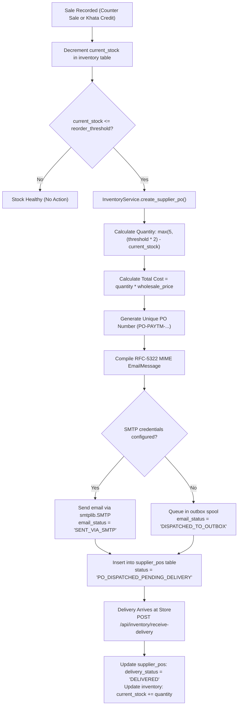
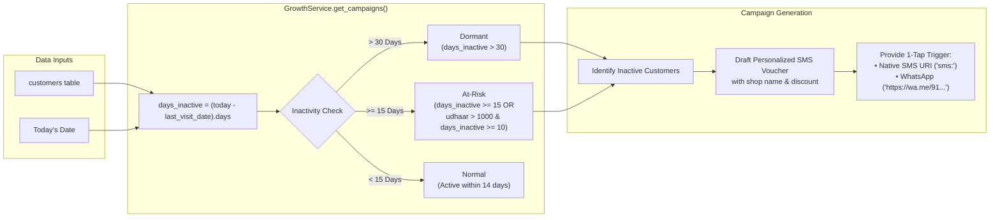
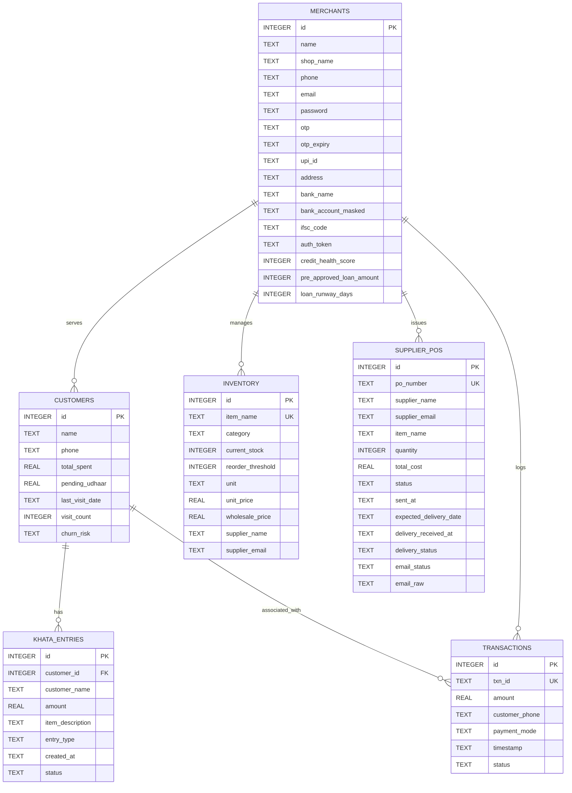

# Paytm Vyapar Saathi (Soundbox AI Retail OS)

> **Voice-First Retail Operating System & Proactive Business Partner for Indian Retail Merchants**  
> **Hackathon Track:** Track 1 — *Merchant Growth AI ("Beyond Payments")*  
> **Event & Finals:** Paytm Build for India AI Hackathon (Paytm HQ, SkymarkOne, Noida)

---


[](https://www.python.org/)
[](https://fastapi.tiangolo.com/)
[-07405E?style=for-the-badge&logo=sqlite&logoColor=white)](https://www.sqlite.org/)
[-00BAF2?style=for-the-badge)](https://developer.mozilla.org/en-US/docs/Web/API/Web_Audio_API)
[](https://paytmvyaparai.onrender.com/)
[](https://paytm-vyapar-ai-chi.vercel.app/)

---

## 1. Quick Testing Guide for Evaluators & Judges

A pre-seeded demo merchant profile is included in the persistent database so you can immediately test all features without manual onboarding:

* **Demo Merchant:** Ramesh Sharma — *Sharma Kirana Store* (Sector 18, Noida)
* **Login Credentials:** `ramesh.kirana@paytm.com` | PIN: `1234` (or click **"Continue as Demo Merchant"**)
* **Reset Database to Clean State:** Click **"Reset Demo Data"** in the top navigation bar at any time to restore the initial baseline of 6 customers, 8 FMCG inventory items, 4 ledger entries, and 75 QR transactions.

---

## 2. Live Cloud Deployment

| Component | Platform | URL | Role |
|---|---|---|---|
| **Frontend Cockpit** | Vercel | [https://paytm-vyapar-ai-chi.vercel.app/](https://paytm-vyapar-ai-chi.vercel.app/) | Static web app, Web Speech recognition, Web Audio API soundbox chime synthesizer |
| **Backend REST API** | Render | [https://paytmvyaparai.onrender.com/](https://paytmvyaparai.onrender.com/) | FastAPI application serving all business logic and SQLite database queries |
| **Interactive API Docs** | Render | [https://paytmvyaparai.onrender.com/docs](https://paytmvyaparai.onrender.com/docs) | Swagger UI for testing all API endpoints directly |

*Note: The Vercel frontend reverse-proxies `/api/*` requests directly to the Render backend via `vercel.json` rewrites.*

---

## 3. Core Capabilities Implemented in Code

### 3.1 Digital Bahi-Khata (Voice-First Ledger)
* **Vernacular Voice Entry:** Shopkeepers speak in Hindi or Hinglish (e.g. *"रमेश ₹450 का सामान ले गए"* or *"मनोज वर्मा 1000 पैड"*).
* **Entity Resolution:** Matches customers by exact full name first, single first name if unambiguous, or phone number.
* **"Chutta" / Settlement Intent:** Phrases like *"चुकता"*, *"छुट्टा कर दो"*, or *"हिसाब क्लियर"* are parsed as full repayment (**JAMA**) and set the pending balance to ₹0.
* **Soundbox Audio Feedback:** Plays a synthesized dual-tone chime (440Hz / 880Hz square wave) and speaks the action aloud in Hindi via the Web Speech API.
* **Confirmation & Undo:** Displays a visual confirmation card with a 5-second countdown timer allowing the merchant to undo misheard entries.
* **Native SMS Reminders:** Generates `sms:` protocol links with embedded `upi://pay` deep links to request pending payments.

### 3.2 Inventory Guardian & Wholesale Reordering
* **Automatic Stock Deduction:** Deducts stock on counter sales or voice-logged credit entries.
* **Low-Stock Detection:** Flags items where `current_stock <= reorder_threshold`.
* **Purchase Order (PO) Generation:** Formats an RFC-5322 MIME email to the distributor with calculated order quantity, unit wholesale cost, and expected delivery date.
* **Email Transmission / Outbox:** Transmits via SMTP if credentials are configured in `.env`; otherwise queues the PO in the `supplier_pos` table with `status = 'PO_DISPATCHED_PENDING_DELIVERY'`.
* **Physical Delivery Receiving:** Exposes `/api/inventory/receive-delivery` to confirm that physical goods arrived before crediting `current_stock`.

### 3.3 Mathematical Credit Underwriting & Working Capital
* **Dynamic Underwriting (0–99 Scale):** Computed from SQLite data on every request:
  - **Cashflow Volume & Velocity (Max 40 pts):** Based on 30-day QR volume and transaction count.
  - **Khata Repayment Discipline (Max 35 pts):** Ratio of recovered credit (`jama`) to total credit issued.
  - **Customer Retention (Max 15 pts):** Ratio of active patrons to total customers.
  - **Store Vintage & Footfall (Max 10 pts):** Scaled by the number of registered patrons.
* **Pre-Approved Facility Calculation:** Sets credit limit between $0.75\times$ and $2.0\times$ 30-day QR volume based on risk tier.
* **Simulated Instant Disbursal:** Validates `amount <= pre_approved_loan`, increments `loan_runway_days`, logs the transaction under `payment_mode = 'Loan_Disbursal'` (isolated from merchant sales volume), and triggers a Soundbox voice announcement.

### 3.4 Merchant Growth AI (RFM Churn Engine)
* **RFM Evaluation:** Evaluates each customer's `last_visit_date`, `visit_count`, and `pending_udhaar`:
  - `Dormant`: Inactive for $> 30$ days.
  - `At-Risk`: Inactive for $\ge 15$ days, or holding $> ₹1,000$ udhaar with $\ge 10$ days inactivity.
  - `Normal`: Active within the last 14 days.
* **Win-Back Campaigns:** Crafts personalized Hindi discount messages with direct WhatsApp (`wa.me/91...`) and native SMS links.

---

## 4. System Architecture

The following diagrams represent the exact architecture implemented in the codebase:

### 4.1 End-to-End System Architecture



---

### 4.2 Voice-to-Action Execution Flow

```mermaid
sequenceDiagram
    autonumber
    actor Merchant as Shopkeeper (Kirana)
    participant UI as Browser Cockpit (app.js)
    participant Audio as Web Audio Synthesizer
    participant Backend as FastAPI (main.py)
    participant Agent as ReactAgent (react_agent.py)
    participant Svc as Domain Services
    participant DB as SQLite (vyapar.db)

    Merchant->>UI: Speaks: "मनोज वर्मा 1000 पैड"
    UI->>Backend: POST /api/agent/chat { message: "मनोज वर्मा 1000 पैड" }
    
    activate Backend
    Backend->>Agent: process_query(message)
    Agent->>Agent: Entity & Intent Resolution ("Manoj Verma", jama, ₹1,000)
    Agent->>Svc: KhataService.record_entry("Manoj Verma", 1000, "jama")
    
    activate Svc
    Svc->>DB: SELECT id, pending_udhaar FROM customers WHERE name LIKE 'Manoj Verma'
    DB-->>Svc: Found customer (pending_udhaar = 1200)
    Svc->>DB: INSERT INTO khata_entries (customer_id, amount=1000, type='jama')
    Svc->>DB: UPDATE customers SET pending_udhaar = 200 WHERE id = 3
    Svc->>DB: INSERT INTO transactions (payment_mode='UPI_Soundbox', amount=1000)
    Svc-->>Agent: Result { customer: "Manoj Verma", new_balance: 200 }
    deactivate Svc

    Agent-->>Backend: Agent Response + Soundbox Payload
    deactivate Agent

    Backend-->>UI: 200 OK (JSON)
    
    par Play Dual-Tone Chime
        UI->>Audio: Play 440Hz -> 880Hz square-wave chime
    and Vernacular Voice Confirmation
        UI->>Audio: SpeechSynthesis: "Paytm par Manoj Verma se 1,000 rupaye jama ho gaye"
    and UI State Refresh
        UI->>UI: Show financial confirmation card with 5s undo timer
        UI->>UI: Update Ledger balances & Recovery Rate
    end
```

---

### 4.3 Mathematical Underwriting & Loan Disbursal Pipeline



---

### 4.4 Inventory Guardian & Supply Chain Reorder Loop



---

### 4.5 RFM Customer Telemetry & Churn Segmentation



---

### 4.6 Database Entity-Relationship (ER) Schema

The exact schema defined in `backend/database.py`:



---

## 5. Vernacular NLP & Entity Resolution Rules

Implemented in `backend/agent/react_agent.py` and `backend/services/chatbot_service.py`:

1. **Dual-Engine Intent Architecture:**
   - **Primary Engine:** Groq LLM API with `qwen/qwen3.8-27b` using native function calling when `GROQ_API_KEY` is present.
   - **Fallback Engine:** Deterministic vernacular parser utilizing exact regex token extraction, word boundaries (`\b(po|diya|likho)\b`), and Devanagari keyword matching.
2. **Customer Matching Order:**
   - Exact case-insensitive full name matching across all database customers.
   - If clean input is a single word, matches against first names only if exactly one customer shares that first name.
   - Phone matching (last 10 digits) if no name match is found.
   - If no customer exists, a new customer record is automatically created.
3. **No Silent Defaults:** If a customer name or transaction amount is missing, the agent does not invent dummy data; it prompts the merchant for the missing information.
4. **Settlement Mapping:** Keywords like *"चुकता"*, *"छुट्टा"*, *"clear"*, *"settle"* map to `entry_type = 'jama'` with the customer's full outstanding balance.

---

## 6. Complete API Reference

| Method | Endpoint | Description |
|---|---|---|
| `POST` | `/api/auth/login` | Authenticate merchant with email & PIN |
| `POST` | `/api/auth/otp/send` | Send simulated 6-digit OTP |
| `POST` | `/api/auth/otp/verify` | Verify OTP and return session token |
| `GET` | `/api/auth/me` | Fetch active merchant session |
| `GET` | `/api/merchant/profile` | Retrieve shop, bank account, and IFSC details |
| `POST` | `/api/agent/chat` | AI agent endpoint (voice/text reasoning & soundbox payload) |
| `GET` | `/api/khata` | Get customer list, pending udhaar, and recent entries |
| `POST` | `/api/khata/entry` | Record an udhaar (debit) or jama (credit) ledger entry |
| `POST` | `/api/khata/settle` | Settle a customer's entire pending balance to ₹0 |
| `POST` | `/api/khata/remind` | Generate a payment reminder text with UPI link |
| `GET` | `/api/inventory` | List all inventory items, low stock counts, and recent POs |
| `POST` | `/api/inventory/reorder` | Draft and dispatch a supplier PO |
| `GET` | `/api/inventory/pos` | List all supplier Purchase Orders |
| `POST` | `/api/inventory/receive-delivery` | Confirm physical goods arrival and restock inventory |
| `GET` | `/api/credit` | Run mathematical underwriting and return credit score & limit |
| `POST` | `/api/credit/disburse` | Execute simulated loan disbursal to merchant bank account |
| `GET` | `/api/growth` | Run RFM evaluation and return customer win-back campaigns |
| `GET` | `/api/transactions` | Retrieve recent Soundbox transactions |
| `GET` | `/api/transactions/profit-trends` | Compute daily turnover and gross profit for the last 7 days |
| `POST` | `/api/system/reset-demo` | Restore SQLite database to initial baseline state |

---

## 7. Local Setup & Execution

### Prerequisites
* Python 3.10+
* Git

### Step-by-Step Instructions

```bash
# 1. Clone the repository
git clone https://github.com/RiyanshiVerma-11/PaytmVyaparAI.git
cd PaytmVyaparAI

# 2. Set up virtual environment
python -m venv venv

# Windows:
venv\Scripts\activate
# Linux/macOS:
source venv/bin/activate

# 3. Install dependencies
pip install -r requirements.txt

# 4. Initialize SQLite database with seed data
python backend/database.py

# 5. Start the application
python -m uvicorn backend.main:app --host 127.0.0.1 --port 8000 --reload
```

Open [http://127.0.0.1:8000](http://127.0.0.1:8000) in your browser.

### Docker Setup

```bash
docker-compose up --build
```

Access the application at [http://localhost:8000](http://localhost:8000).

---

## 8. Team & Venue

* **Project:** Paytm Vyapar Saathi
* **Team:** Riyanshi Verma & Team
* **Hackathon:** Paytm Build for India AI Hackathon
* **Venue:** Paytm Headquarters, SkymarkOne, Tower D, Sector 98, Noida, Uttar Pradesh 201304
* **Track:** Track 1 — *Merchant Growth AI ("Beyond Payments")*
