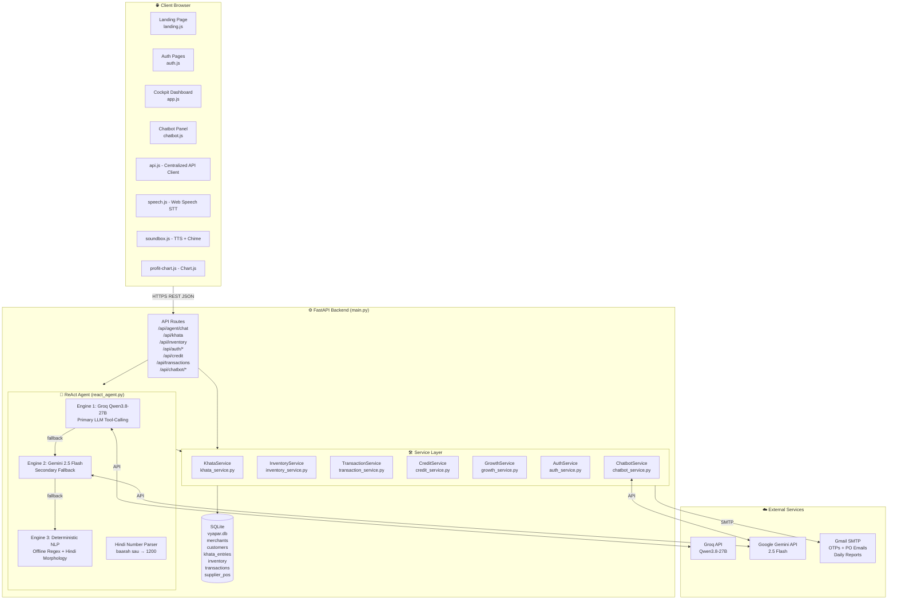
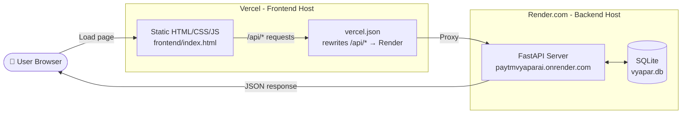
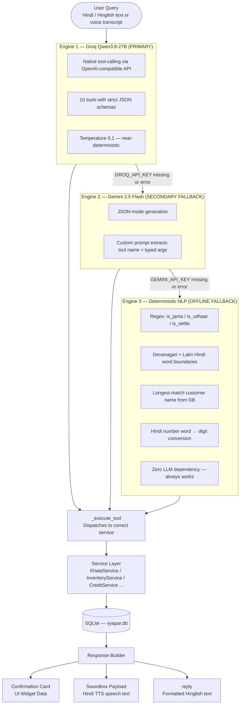
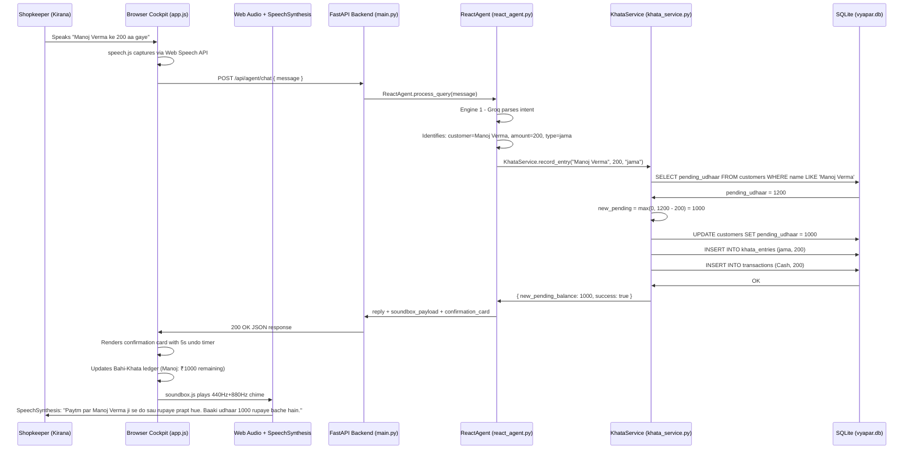
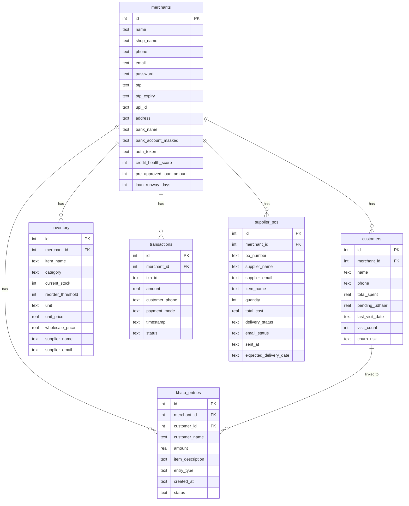
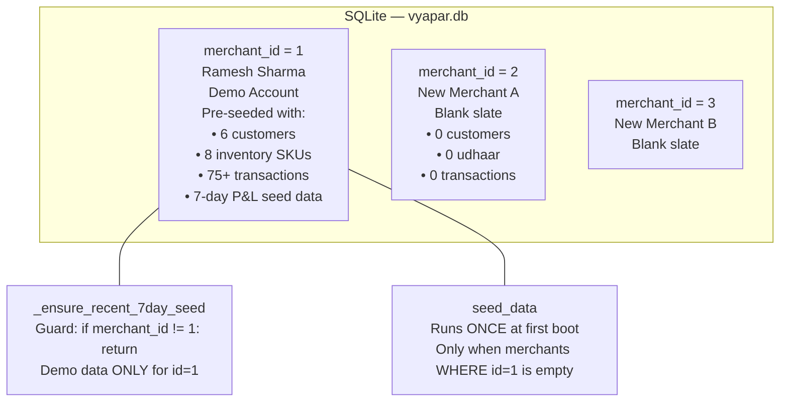

# 🏪 Paytm Vyapar Saathi — AI Retail Copilot for Indian Kirana Merchants

<div align="center">


**An autonomous AI-powered business operations copilot for Indian Kirana & retail merchants.**
Voice commands → Instant Bahi-Khata entries, Inventory restocks, Credit scoring, UPI analytics — in Hindi/Hinglish.

</div>

---

## 📌 Table of Contents

1. [What is Paytm Vyapar Saathi?](#-what-is-paytm-vyapar-saathi)
2. [Core Features](#-core-features)
3. [System Architecture](#-system-architecture)
4. [Project Structure](#-project-structure)
5. [AI Agent Pipeline](#-ai-agent-pipeline)
6. [Voice-to-Action Flow](#-voice-to-action-flow)
7. [Database Schema](#-database-schema)
8. [API Reference](#-api-reference)
9. [Frontend Modules](#-frontend-modules)
10. [Demo Quick Start](#-demo-quick-start)
11. [Local Development](#-local-development)
12. [Environment Variables](#-environment-variables)
13. [Deployment](#-deployment)
14. [Multi-Tenant Architecture](#-multi-tenant-architecture)

---

## 🎯 What is Paytm Vyapar Saathi?

**Paytm Vyapar Saathi** is a full-stack AI copilot built for India''s 65 million+ Kirana (neighborhood grocery) shop owners. Merchants simply **speak in Hindi or Hinglish** — the system understands and executes complex business operations autonomously.

### The Problem It Solves

| Pain Point | Traditional Way | With Vyapar Saathi |
|---|---|---|
| Udhaar (credit) tracking | Paper notebook, prone to loss | Voice → instant DB entry |
| Partial payment tracking | Manual math on paper | Auto-subtraction from balance |
| Inventory restock | Phone call to supplier | AI generates & emails PO |
| Profit visibility | End-of-month calculation | Real-time 7-day P&L chart |
| Working capital | Banks deny without docs | AI credit score → instant loan |

---

## ✨ Core Features

### 1. 🗣️ Voice-First AI Agent (Hindi/Hinglish)

The heart of the app. A **3-engine ReAct agent** processes natural language voice commands:

- **"Manoj Verma ke ₹200 aa gaye"** → Records ₹200 jama, shows ₹1,000 remaining balance
- **"Prachi, ₹500 aata udhaar darj karein"** → Creates udhaar entry + decrements Atta inventory
- **"Ramesh ka hisab chukta karo"** → Fully settles pending balance in one shot
- **"Fortune Oil ka order karo"** → Generates supplier PO + dispatches email
- **"₹25,000 loan chahiye"** → Checks eligibility, disburses working capital

**Hindi number word recognition:** `baarah sau` → 1200, `dhai hazaar` → 2500, `ek lakh` → 100000

### 2. 📒 Bahi-Khata Ledger (Digital Credit Book)

- **Udhaar entry** — Customer takes goods on credit; balance auto-increments
- **Jama (partial payment)** — `pending = max(0, current - paid)` — handles partial payments correctly
- **Full settlement** — One command clears entire balance
- **Undo** — Rollback any mistaken entry with balance reversal
- **Auto SMS URI** — Generates deep-link SMS with UPI payment request to customer
- **Inventory auto-decrement** — Udhaar for oil/atta/salt reduces live stock count

### 3. 📦 Inventory Management & Supplier POs

- Live stock levels for 8+ Kirana SKUs (Amul Butter, Fortune Oil, Maggi, Tata Salt, etc.)
- **Low-stock alerts** — Items below reorder threshold flagged in dashboard
- **Supplier PO email dispatch** — AI calculates restock quantity, generates HTML email
- **Delivery receipt tracking** — Mark PO as received → stock auto-increments
- **Per-SKU margin calculation** — `(unit_price - wholesale_price) / unit_price`

### 4. 💳 AI Credit Health & Working Capital Loans

- **Paytm Credit Score (0–100)** — Computed from Soundbox UPI volume + transaction frequency
- **Pre-approved loan limits** — Auto-calculated from 30-day Soundbox throughput
- **Simulated RTGS disbursal** — Loan credited to merchant bank (simulation mode)
- **Runway calculator** — Shows how many days working capital will last

### 5. 📊 Real-Time Profit Dashboard

- **Per-SKU margin engine** — Matches each transaction to inventory for exact margins
- **Micro-sale detection** — Cash micro-sales (Maggi, Dahi ≤ ₹60) tracked separately
- **Day-over-day growth %** — Compares today profit vs yesterday
- **Daily P&L email** — Full HTML report dispatched via Gmail SMTP

### 6. 🔔 UPI Soundbox Simulation

- **Hindi TTS** — Browser `SpeechSynthesis` announces every payment in Hindi
- **Dual-tone chime** — Web Audio API generates 440Hz + 880Hz square-wave chime

### 7. 🤖 AI Chatbot

Separate conversational chatbot powered by Gemini 2.5 Flash with full app context awareness.

### 8. 🔐 Multi-Tenant Auth System

- Merchant registration (shop name, UPI ID, address)
- Email/phone login + OTP-based password reset via Gmail SMTP
- Each merchant fully isolated by `merchant_id`

### 9. 📈 Customer Churn Prediction

- **At-Risk** — No visit in 30+ days · **Dormant** — No visit in 45+ days
- Win-back discount campaigns + festive demand surge predictions

### 10. 📧 Daily Profit Pulse Email

HTML email with collections, profit, udhaar summary, low-stock alerts, credit score.

---

## 🏗️ System Architecture



---

## 🚀 Deployment Architecture



---

## 📁 Project Structure

```
PaytmVyaparAI/
│
├── backend/
│   ├── main.py                     # FastAPI entry point — all 30+ API routes (356 lines)
│   ├── database.py                 # SQLite schema, migrations, seed data (267 lines)
│   ├── vyapar.db                   # SQLite database (committed for Vercel parity)
│   │
│   ├── agent/
│   │   └── react_agent.py          # 3-engine ReAct agent + Hindi NLP (1140 lines)
│   │
│   └── services/
│       ├── khata_service.py        # Bahi-Khata CRUD, partial payment, undo (358 lines)
│       ├── inventory_service.py    # Stock management, PO creation & receipt
│       ├── transaction_service.py  # UPI analytics, 7-day P&L, email reports (538 lines)
│       ├── credit_service.py       # Credit score engine, loan disbursal
│       ├── growth_service.py       # Churn detection, win-back campaigns
│       ├── auth_service.py         # Registration, login, OTP flow (265 lines)
│       └── chatbot_service.py      # Gemini-powered chatbot with app context
│
├── frontend/
│   ├── index.html                  # Full SPA — all pages in one file (132 KB)
│   │
│   ├── css/
│   │   ├── variables.css           # Design tokens (colors, fonts, spacing)
│   │   ├── landing.css             # Marketing landing page
│   │   ├── auth.css                # Login / register pages
│   │   ├── cockpit.css             # Main dashboard (100 KB)
│   │   ├── chatbot.css             # Chatbot panel
│   │   ├── components.css          # Reusable UI components
│   │   └── layout.css              # Grid and layout utilities
│   │
│   └── js/
│       ├── app.js                  # Cockpit dashboard logic (98 KB)
│       ├── api.js                  # Centralized API client
│       ├── auth.js                 # Auth flows (25 KB)
│       ├── chatbot.js              # Chatbot UI + session (20 KB)
│       ├── speech.js               # Web Speech API STT
│       ├── soundbox.js             # Audio chime + Hindi TTS
│       ├── profit-chart.js         # Chart.js P&L charts (719 KB bundled)
│       ├── profit-chart.jsx        # React JSX source
│       ├── landing.js              # Landing animations
│       └── antigravity-motion.js   # Particle effects
│
├── server.py                       # Alternative Uvicorn entry point
├── vercel.json                     # Vercel rewrite config
├── Dockerfile                      # Docker definition
├── docker-compose.yml              # Docker Compose
├── requirements.txt                # Python deps (FastAPI, Uvicorn, Groq, etc.)
└── .env.example                    # Environment variable template
```

---

## 🤖 AI Agent Pipeline



### Supported Agent Tools

| Tool | Trigger Examples | Service |
|---|---|---|
| `record_khata_entry` | "Manoj ₹500 udhaar", "Prachi ne ₹200 diye" | `KhataService.record_entry()` |
| `settle_khata_customer` | "Ramesh ka hisab chukta", "poora settle karo" | `KhataService.record_entry(jama)` |
| `get_khata_details` | "Ramesh ka kitna baaki hai?" | SQLite direct query |
| `create_supplier_po` | "Fortune Oil order karo" | `InventoryService.create_supplier_po()` |
| `receive_supplier_delivery` | "PO-PAYTM-XXXXX receive hua" | `InventoryService.receive_supplier_delivery()` |
| `get_inventory_health` | "stock kya hai?" | `InventoryService.get_inventory()` |
| `get_credit_health` | "mera credit score kya hai?" | `CreditService.get_merchant_credit_health()` |
| `disburse_loan` | "₹25,000 loan chahiye" | `CreditService.disburse_loan()` |
| `get_growth_campaigns` | "kaun sa customer nahi aaya?" | `GrowthService.get_campaigns()` |
| `send_daily_profit_pulse_email` | "aaj ka report email karo" | `TransactionService.send_daily_profit_pulse_email()` |

### Hindi Number Word Parser

| Hindi / Hinglish Input | Parsed Value |
|---|---|
| `sau` | 100 |
| `do sau` | 200 |
| `dhai sau` | 250 |
| `teen sau` | 300 |
| `saadhe teen sau` | 350 |
| `paanch sau` | 500 |
| `ek hazaar` | 1,000 |
| `baarah sau` | 1,200 |
| `dedh hazaar` | 1,500 |
| `dhai hazaar` | 2,500 |
| `paanch hazaar` | 5,000 |
| `ek lakh` | 1,00,000 |

---

## 🗣️ Voice-to-Action Flow

Example: Merchant says **"Manoj Verma ke ₹200 aa gaye"**



---

## 🗄️ Database Schema



### Key Business Logic

**Partial Payment Balance** (`khata_service.py` line 100):
```python
new_pending = (curr_pending + amount) if entry_type == "udhaar" \
              else max(0.0, curr_pending - amount)
# Example: Manoj has ₹1,200 → pays ₹200 → max(0, 1200-200) = ₹1,000 remaining
```

**Per-SKU Profit Margin** (`transaction_service.py`):
```python
margin = (unit_price - wholesale_price) / unit_price
# Fortune Oil: (145 - 130) / 145 = 10.3%
# Micro-cash fallback (Dahi, Maggi ≤ ₹60): 21%
```

---

## 🌐 API Reference

**Production:** `https://paytmvyaparai.onrender.com`  
**Local:** `http://localhost:8000`

### Auth

| Method | Endpoint | Description |
|---|---|---|
| POST | `/api/auth/register` | Register new merchant |
| POST | `/api/auth/login` | Login email/phone + password |
| POST | `/api/auth/forgot-password/send-otp` | Send OTP to registered email |
| POST | `/api/auth/forgot-password/verify-otp` | Verify OTP, set new password |
| GET | `/api/merchant/profile?merchant_id=1` | Fetch merchant profile |
| POST | `/api/merchant/update-email` | Update email address |

### AI Agent

| Method | Endpoint | Description |
|---|---|---|
| POST | `/api/agent/chat` | Process voice/text via 3-engine ReAct agent |

**Request:** `{ "query": "Manoj Verma ke ₹200 aa gaye" }`

**Response:**
```json
{
  "action_name": "RECORD_KHATA_ENTRY",
  "thoughts": ["Engine 1 Groq: parsed jama intent", "Tool: record_khata_entry {amount:200}"],
  "result": { "new_pending_balance": 1000, "entry_type": "jama", "customer_name": "Manoj Verma" },
  "reply": "✅ Jama Darj Ho Gayi! Baaki Pending: ₹1,000",
  "confirmation_card": { "action": "JAMA_PAYMENT", "amount": 200, "status": "SAVED_TO_DATABASE" },
  "soundbox_payload": {
    "chime": true,
    "speech_text": "Paytm par Manoj Verma ji se do sau rupaye prapt hue. Baaki udhaar 1000 rupaye bache hain."
  }
}
```

### Bahi-Khata

| Method | Endpoint | Description |
|---|---|---|
| GET | `/api/khata` | All entries + customer balances |
| POST | `/api/khata/entry` | Add udhaar or jama entry |
| POST | `/api/khata/settle` | Fully settle `{ customer_id }` |
| POST | `/api/khata/entry/undo` | Rollback entry `{ entry_id }` |

### Inventory

| Method | Endpoint | Description |
|---|---|---|
| GET | `/api/inventory` | All SKUs with stock + alerts |
| POST | `/api/inventory/item` | Add or update inventory item |
| POST | `/api/inventory/po` | Create supplier purchase order |
| POST | `/api/inventory/po/receive` | Mark PO delivered, update stock |

### Credit & Loans

| Method | Endpoint | Description |
|---|---|---|
| GET | `/api/credit?merchant_id=1` | Credit score + loan eligibility |
| POST | `/api/credit/disburse` | Disburse working capital `{ amount }` |

### Transactions & Analytics

| Method | Endpoint | Description |
|---|---|---|
| GET | `/api/transactions` | All transactions + P&L summary |
| GET | `/api/transactions/profit-trends?days=7` | Daily P&L for last N days |
| POST | `/api/transactions/simulate` | Simulate Soundbox UPI payment |
| POST | `/api/transactions/daily-pulse-email` | Send P&L email report |

### Chatbot & Growth

| Method | Endpoint | Description |
|---|---|---|
| POST | `/api/chatbot/message` | `{ message, session_id }` to Gemini chatbot |
| POST | `/api/chatbot/clear` | Clear session history |
| GET | `/api/growth` | At-risk customers + win-back campaigns |

### Demo Management

| Method | Endpoint | Description |
|---|---|---|
| POST | `/api/demo/reset` | Reset demo data to baseline (for judges) |
| GET | `/api/demo/status` | Get demo credentials + status |

---

## 🖥️ Frontend Modules

| Section | JS | CSS | Description |
|---|---|---|---|
| Landing Page | `landing.js` | `landing.css` | Marketing page with feature showcase |
| Login / Register | `auth.js` | `auth.css` | Multi-step auth with OTP flow |
| Cockpit Dashboard | `app.js` | `cockpit.css` | Main merchant dashboard |
| AI Voice Panel | `app.js` + `speech.js` + `soundbox.js` | `cockpit.css` | Voice command + chime |
| Bahi-Khata Tab | `app.js` | `cockpit.css` | Customer ledger + undo |
| Inventory Tab | `app.js` | `cockpit.css` | Stock levels + PO management |
| Analytics Tab | `profit-chart.js` | `cockpit.css` | 7-day P&L bar charts |
| Credit Tab | `app.js` | `cockpit.css` | Credit score ring + loan panel |
| Chatbot Panel | `chatbot.js` | `chatbot.css` | Floating Gemini AI assistant |

**Key capabilities:**
- `speech.js` — Browser STT via Web Speech API → sends transcript to `/api/agent/chat`
- `soundbox.js` — Plays 440Hz+880Hz chime + Hindi TTS on every payment
- `profit-chart.js` — Chart.js 7-day revenue/profit/COGS interactive bar chart
- Every action shows a **5-second undo button** with animated countdown
- Khata responses served with `Cache-Control: no-store` for always-fresh data

---

## 🚀 Demo Quick Start

### Credentials (Hackathon / Judge Access)

| Field | Value |
|---|---|
| Email | `ramesh.kirana@paytm.com` |
| PIN | `1234` |
| Shop | Sharma Kirana Store, Sector 18, Noida |

### Sample Voice Commands

```
📒 Udhaar (Credit entries):
"Prachi, paanch sau rupaye aata udhaar darj karein"
"Ramesh Kumar, do sau rupaye salt aur tel udhaar"

💰 Jama (Payment received):
"Manoj Verma ke do sau rupaye aa gaye"
"Pooja ne baarah sau rupaye de diye"

✅ Full settlement:
"Ramesh ka hisab chukta karo"
"Sunil Yadav ka poora udhaar settle kar do"

📦 Inventory:
"Fortune Oil ka stock kitna bacha hai?"
"Amul Butter ka order karo"

💳 Credit & Loans:
"Mera credit score kya hai?"
"Paanch hazaar rupaye ka loan chahiye"

📊 Reports:
"Aaj ka P&L report email karo"
"Total kitna udhaar baaki hai?"
```

---

## 🛠️ Local Development

```bash
# 1. Clone
git clone https://github.com/RiyanshiVerma-11/PaytmVyaparAI.git
cd PaytmVyaparAI

# 2. Install dependencies
pip install -r requirements.txt

# 3. Configure environment
cp .env.example .env
# Edit .env with your API keys

# 4. Initialize database
cd backend
python database.py
# Output: Vyapar Database Initialized and Seeded Successfully!

# 5. Start server
uvicorn main:app --reload --port 8000

# 6. Open browser → http://localhost:8000
```

---

## 🔑 Environment Variables

```env
# AI Engines (at least one required for LLM features)
GROQ_API_KEY=gsk_xxxxxxxxxxxx        # Primary: Groq Qwen3.8-27B
GEMINI_API_KEY=AIzaSyxxxxxxxxxx      # Secondary: Gemini 2.5 Flash

# Email (SMTP) — OTP delivery, PO emails, daily P&L reports
SMTP_HOST=smtp.gmail.com
SMTP_PORT=587
SMTP_USER=your-gmail@gmail.com
SMTP_PASS=your-app-password          # Gmail App Password (16-char)
SMTP_FROM_NAME=Vyapar Saathi

# Server
PORT=8000
```

> 💡 Without any AI key the deterministic engine handles all standard Kirana commands offline.

---

## 🚢 Deployment

### Vercel (Frontend)

```json
{
  "outputDirectory": "frontend",
  "rewrites": [
    { "source": "/api/(.*)", "destination": "https://paytmvyaparai.onrender.com/api/$1" }
  ]
}
```

Connect GitHub → Vercel auto-deploys on every push to `main`.

### Render.com (Backend)

- **Build:** `pip install -r requirements.txt`
- **Start:** `cd backend && uvicorn main:app --host 0.0.0.0 --port $PORT`

### Docker

```bash
docker-compose up --build
```

---

## 🏢 Multi-Tenant Architecture



All service queries filter by `merchant_id`. New registrations get a fresh row — no demo data copied.

---

## 🧪 Tech Stack Summary

| Layer | Technology |
|---|---|
| Backend Framework | FastAPI 0.109+ |
| ASGI Server | Uvicorn |
| Database | SQLite (`sqlite3` stdlib) |
| Primary AI | Groq API — Qwen3.8-27B (native tool-calling) |
| Secondary AI | Google Gemini 2.5 Flash (JSON-mode) |
| Fallback Engine | Custom deterministic NLP (regex + Hindi morphology) |
| Frontend | Vanilla HTML5 + CSS3 + JavaScript ES6+ |
| Charts | Chart.js (bundled in `profit-chart.js`) |
| Speech Input | Browser Web Speech API (STT) |
| Speech Output | Browser SpeechSynthesis API (Hindi TTS) |
| Audio Chime | Web Audio API (440Hz + 880Hz square-wave) |
| Email | Python `smtplib` via Gmail SMTP |
| Frontend Host | Vercel |
| Backend Host | Render.com |
| Container | Docker + Docker Compose |

---

## 👩‍💻 Author

**Riyanshi Verma**  
Built for **Paytm Build for India AI Hackathon 2026 — SheBuilds Track**

> *Empowering India''s 65 million Kirana merchants with AI-first business intelligence, one voice command at a time.*

---

<div align="center">

**Paytm Vyapar Saathi** · Built with ❤️ for Bharat''s Kirana shopkeepers  
Powered by FastAPI · Groq · Gemini · Paytm Soundbox 4.0 Pro

</div>
