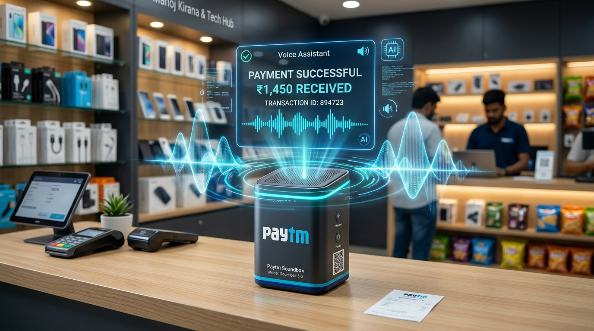
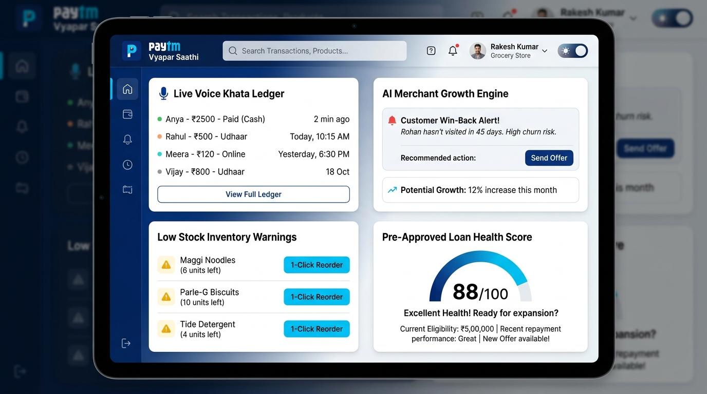

# 🏆 Paytm Vyapar Saathi — Official Hackathon Presentation Deck
> **Hackathon:** Paytm Build for India AI Hackathon – Delhi (Offline Finals @ Paytm HQ, SkymarkOne, Noida)  
> **Platform:** devSemble  
> **Team Name:** **SheBuilds**  
> **Team Members:** **Riyanshi Verma**, **Radhika Gupta**, **Gauri Singh Rawat**  
> **Selected Track:** **Track 1: Merchant Growth AI ("Beyond Payments")**  
> **Official Challenge:** *"Build the AI business partner for every Paytm merchant. Build scalable AI-led solutions that help Paytm merchants grow their business, manage operations, and serve customers better. Think beyond payments, identify opportunities where AI can become a trusted business copilot for millions of merchants."*  
> **Live Prototype URL:** [https://paytm-vyapar-ai-chi.vercel.app/](https://paytm-vyapar-ai-chi.vercel.app/)  
> **Backend API Docs:** [https://paytmvyaparai.onrender.com/docs](https://paytmvyaparai.onrender.com/docs)  
> **GitHub Repository:** [https://github.com/RiyanshiVerma-11/PaytmVyaparAI](https://github.com/RiyanshiVerma-11/PaytmVyaparAI)  
> **Preloaded Demo Merchant:** `ramesh.kirana@paytm.com` | PIN: `1234` (Sharma Kirana Store, Sector 18 Market, Noida)

---

## 📌 Slide 1: Title Slide (The Intelligent Soundbox)



### **Slide Content:**
* **Project Name:** **Paytm Vyapar Saathi**
* **Headline:** *"The Soundbox that becomes a merchant’s autonomous business copilot."*
* **Track:** **PAYTM : TRACK 1 — Merchant Growth AI (Beyond Payments 🎙️)**
* **Tagline:** *"Turning every Paytm Soundbox into an autonomous CFO, Supplier Manager, and Revenue Partner for Bharat."*
* **Core Value:** **Zero-Typing Voice Input · 1-Tap Official WhatsApp (`wa.me`) & Native SMS · 100% Backward-Compatible Soundbox OS**
* **Team Details:** 
  * **Team Name:** **SheBuilds**
  * **Members:** Riyanshi Verma, Radhika Gupta, Gauri Singh Rawat
  * **Event Venue:** Paytm Headquarters, SkymarkOne, Sector 98, Noida, Uttar Pradesh 201304
* **Live Evaluation Links:**
  * **Interactive Cockpit:** [https://paytm-vyapar-ai-chi.vercel.app/](https://paytm-vyapar-ai-chi.vercel.app/)
  * **GitHub Repository:** [https://github.com/RiyanshiVerma-11/PaytmVyaparAI](https://github.com/RiyanshiVerma-11/PaytmVyaparAI)
  * **Demo Login:** `ramesh.kirana@paytm.com` | PIN: `1234` (1-Click *"Continue as Demo Merchant"*)

> **🎙️ Speaker Notes (Slide 1):**  
> *"Respected judges and the Paytm engineering leadership, we are Team SheBuilds. Paytm transformed Indian retail by placing an iconic QR code and Soundbox on 10 million counters. Today, we present 'Paytm Vyapar Saathi'—an autonomous AI business copilot that upgrades that passive payment speaker into an active retail operating system. It manages store operations before and after transactions without requiring any new hardware capex or complicated apps."*

---

## 📌 Slide 2: The Merchant Problem (The Ground Reality of Bharat)

### **Slide Content:**
**Headline:** *"Payments are solved. The work around them is not."*  
**Sub-Headline:** *"For a busy kirana owner, growth leaks out before and after every transaction."*

#### 👤 Ramesh Sharma's Day (Sharma Kirana Store, Sector 18 Market, Noida):
*One shop, ₹1.2 Lakh Crore trapped in 4 daily operational failures:*

1. **Udhaar gets forgotten:** During peak evening rush (6 PM–9 PM), 4 customers shout orders simultaneously. Credit slips past the counter unrecorded.
2. **Stockouts arrive late:** Discovered only when a customer asks for 5kg Fortune Oil and leaves empty-handed to a competitor.
3. **Loyalty quietly shifts:** Regular neighborhood families silently migrate to 10-minute quick-commerce delivery apps with zero merchant retention tools.
4. **Bookkeeping steals the night:** Spends 90 exhausting minutes tallying paper *Bahi-Khata*, counting cash, and worrying about working capital expansion loans.

| # | Ground Reality Pain Point | Impact on 30M+ Indian Merchants | Why Existing Apps (Khatabook/POS) Fail |
|---|---|---|---|
| **1** | **The Paper Udhaar Trap** | ₹1.2 Lakh Cr trapped in uncollected credit; 20-30% lost forever. | Requiring shopkeepers to search menus and type names during peak counter rush is impossible. |
| **2** | **Blind Inventory & Stockouts** | Stockouts discovered only when customers leave empty-handed. | Small stores have 2,000 un-barcoded items; manual barcode scanning is impractical. |
| **3** | **Silent Customer Churn** | 40% of regular customers churn to quick-commerce unnoticed. | Local merchants have no automated marketing tools or customer retention systems. |
| **4** | **Credit & Capital Disconnect** | Unable to access formal working capital loans to renovate or restock. | Banks demand 3-year audited ITRs, ignoring daily Soundbox UPI cashflow consistency. |

> **🎙️ Speaker Notes (Slide 2):**  
> *"Look at Ramesh Sharma's reality at Sharma Kirana in Sector 18, Noida—right down the road from Paytm HQ. Digital payment sound is instant, but everything before and after is deeply broken. During evening counter rush, shopkeepers cannot unlock phones, browse nested menus, or type. Unrecorded credit and blind stockouts bleed merchant profits. Payments are solved; retail store operations are not."*

---

## 📌 Slide 3: The Product (Voice-First Operating System for Bharat)



### **Slide Content:**
**Headline:** *"Meet Vyapar Saathi: A Voice-First Operating System for Bharat."*  
**Sub-Headline:** *"An autonomous ReAct agent turning payment telemetry and natural voice commands into actions across 4 Core Pillars."*

### 🚀 1. Grow Their Business (Merchant Growth AI)
* **Zero-Setup QR Telemetry CRM:** Every incoming Paytm QR payment automatically logs customer visit recency and transaction velocity with zero manual merchant typing.
* **Dynamic RFM Churn Win-Back:** Automatically detects inactive regular patrons (*"Customer #9811 hasn't visited in 34 days — Churn Risk"*).
* **1-Tap WhatsApp & Native SMS Vouchers:** Generates instant 1-tap pre-filled discount vouchers with embedded direct UPI payment links (`wa.me` & `sms:`)—**100% ban-proof with zero 3rd-party scraper bot risk**.
* **Festival Surge & Demand Forecaster:** Predicts seasonal demand spikes 7 days before major festivals (Diwali, Navratri) to lock in wholesale bulk discounts.

### ⚙️ 2. Manage Operations (Autonomous Copilot)
* **Zero-Touch Voice Khata:** Shopkeeper speaks naturally in Hindi, Hinglish, or English:  
  * *"Ramesh bhai ko ₹450 ka refine tel udhaar diya, note karlo."*  
  * *"मनोज वर्मा 1000 पैड"* or *"मनोज वर्मा सेटल"* (dynamically resolves balance to ₹0).
* **Automated Wholesale Email POs (Python SMTP):** Auto-drafts and dispatches professional RFC-5322 MIME Purchase Orders directly to distributors when inventory drops below safety thresholds.
* **Real SKU Unit Economics & Profit Pulse:** Calculates actual gross margin trends based on stored wholesale costs vs. retail selling prices.

### ❤️ 3. Serve Customers Better (Trust & Transparency)
* **Two-Way Soundbox Voice Handshake:** Instant dual-tone chime (440Hz / 880Hz) + vernacular Hindi confirmation (*"Paytm par Ramesh ji ka char sau pachaas rupaye udhaar darj ho gaya"*).
* **Instant Digital E-Receipts:** Itemized digital bills shared via 1-tap WhatsApp or native SMS, eliminating billing disputes.
* **Fail-Safe 1-Tap Undo Safeguard:** 5-second on-screen safety countdown allowing instant voice or button rollback if misheard.

### 💳 4. Beyond Payments (Paytm Lending Rails)
* **0–100 Credit Health Score:** Mathematically underwrites working capital eligibility based on real transaction velocity and Khata recovery discipline.
* **Simulated Instant Capital Disbursal:** Instant working capital credit directly into merchant bank accounts with authentic Soundbox voice confirmation.

> **🎙️ Speaker Notes (Slide 3):**  
> *"Vyapar Saathi is built around 4 actionable pillars. Notice our outreach architecture: we eliminate ban-prone WhatsApp backend scrapers by using official 1-tap client-side WhatsApp Click-to-Chat deep links (`wa.me`) and native SMS URI protocols. For wholesale distributors, we use production-grade Email SMTP. The iconic Soundbox chime provides two-way verbal acoustic trust, ensuring the customer and shopkeeper both hear the exact amount agreed upon."*

---

## 📌 Slide 4: Technology & Tech Stack Used (The System)

### **Slide Content:**
**Headline:** *"Built to work with Paytm, not around it."*  
**Sub-Headline:** *"Sub-800ms Groq ReAct Agent (`qwen/qwen3.8-27b`) with 9 tools & 100% offline deterministic fallback."*

```
                               ┌──────────────────────────────────────────────┐
                               │    Paytm Merchant Cockpit (Web / Mobile)     │
                               │  • Web Speech API (Hinglish/Hindi NLP)       │
                               │  • Web Audio API Soundbox Chime Synthesizer  │
                               │  • Real-Time ReAct Agent Telemetry Stream    │
                               └──────────────────────┬───────────────────────┘
                                                      │ REST / SSE API
                                                      ▼
                               ┌──────────────────────────────────────────────┐
                               │      FastAPI Backend & Agent Controller      │
                               │  • Groq LPU ReAct Engine (qwen/qwen3.8-27b)  │
                               │  • High-Speed Regex Deterministic Fallback   │
                               │  • Strict Word-Boundary Entity Extraction    │
                               └──────────────────────┬───────────────────────┘
                                                      │
       ┌───────────────────────────┬──────────────────┴────────────────┬───────────────────────────┐
       ▼                           ▼                                   ▼                           ▼
 ┌──────────────┐          ┌──────────────┐                    ┌──────────────┐            ┌──────────────┐
 │ Tools 1-3:   │          │ Tools 4-6:   │                    │ Tool 7:      │            │ Tools 8-9:   │
 │ Voice Khata, │          │ Stock Health,│                    │ Credit Score │            │ Churn Growth,│
 │ Settle,      │          │ PO Dispatch, │                    │ Underwriting │            │ Loan Instant │
 │ Balance Query│          │ Delivery Rcv │                    │ Engine (0-100│            │ Disbursal    │
 └──────┬───────┘          └──────┬───────┘                    └──────┬───────┘            └──────┬───────┘
        │                         │                                   │                           │
        └─────────────────────────┴─────────────────┬─────────────────┴───────────────────────────┘
                                                    ▼
                               ┌──────────────────────────────────────────────┐
                               │      SQLite Persistent Store (ANSI SQL)      │
                               │  • merchants  • customers  • khata_entries   │
                               │  • inventory  • transactions • supplier_pos  │
                               └──────────────────────────────────────────────┘
```

### **Paytm Enterprise Stack Mapping:**
* **Paytm Soundbox IoT Protocol:** Maps 1-to-1 with MQTT topic `merchant/{MID}/soundbox/tts` for two-tone chime and Hindi TTS playback.
* **Paytm Payment Gateway Webhook:** Ingests live telemetry via `POST /v1/merchant/callback` for instant volume aggregation.
* **Paytm Merchant Lending Rails:** Connects to `POST /v2/lending/merchant/underwrite` and `/disburse` using 5-factor mathematical underwriting.
* **Paytm Payouts B2B API:** Simulates wholesale restock order payouts via `POST /v1/payouts/transfer`.
* **Universal UPI Intent:** Real mobile intent link `upi://pay?pa=8171008964@ptaxis` supporting PhonePe, GPay, and Paytm.

> **🎙️ Speaker Notes (Slide 4):**  
> *"From an engineering perspective, this requires zero new hardware investment from Paytm. The audio streams directly to existing 4G Soundboxes over standard MQTT channels. Our ReAct agent runs on Groq LPU hardware with Qwen 27B for sub-800ms vernacular entity extraction, backed by a deterministic regex engine that ensures zero downtime even during counter internet drops."*

---

## 📌 Slide 5: USP (Why This Wins)

### **Slide Content:**
**Headline:** *"Our moat is operational trust."*  
**Sub-Headline:** *"Vyapar Saathi wins because it is designed for the counter rush, not the demo screen."*

| Trust Dimension | Generic Chatbots (ChatGPT/Wrappers) | Traditional POS (Khatabook/Apps) | 🏆 Paytm Vyapar Saathi |
|---|---|---|---|
| **Input Modality** | English typing only | Nested menus, manual search | **Zero-Touch Voice** in Hinglish, Hindi & English |
| **Counter Rush Ready**| No (takes 45+ seconds per prompt) | No (too many clicks) | **5-Second Voice Execution** |
| **Customer Memory** | Manual CRM entry | Requires manual contact sync | **Zero-Setup CRM from Paytm QR Telemetry** |
| **Outreach Model** | Unofficial bots (Meta Account Bans!)| Push notifications / manual SMS | **1-Tap Official WhatsApp (`wa.me`), SMS & SMTP** |
| **Acoustic Reliability**| Hallucinates fake numbers | Silent screen receipt only | **Soundbox Repeat-Back + 1-Tap Undo Safeguard** |
| **Inventory Integrity**| Blind guessing | Requires 2,000 barcode scans | **Deferred Delivery Verification (Zero Phantom Stock)** |
| **Entity Safety** | Defaults to fake customers | Static forms | **Zero Silent Fallbacks (Prompts for Clarification)** |
| **Operating Layer** | Software silo outside Paytm | Standalone app | **Native Paytm Soundbox Hardware Moat** |

### **The 3 Unfair Advantages:**
1. **The Soundbox Audio Trust:** Vernacular repetition creates immediate psychological agreement between merchant and customer.
2. **Zero-Setup Customer CRM:** Customer visit frequency and churn risks derived automatically from incoming Paytm QR telemetry.
3. **Ban-Proof Outreach Architecture:** Combining official client-side WhatsApp Click-to-Chat deep links (`wa.me`) with native SMS and SMTP email.

> **🎙️ Speaker Notes (Slide 5):**  
> *"Our unfair advantage is practical realism. While other teams propose WhatsApp bots that get banned by Meta within 48 hours, we use official client-side WhatsApp Click-to-Chat and native SMS deep links with zero server-side ban risk. Unlike generic LLMs that silently invent fake numbers, our agent has zero silent fallbacks—if details are missing, it asks for clarification."*

---

## 📌 Slide 6: Impact & Benefits (The Paytm Flywheel)

### **Slide Content:**
**Headline:** *"More time, fewer stockouts, stronger merchant retention."*  
**Sub-Headline:** *"One copilot creates value for both sides of the Paytm relationship."*

### 🏪 For the Merchant (Dukaandar):
* ⏱️ **Save 90+ Minutes Daily:** Hands-free voice commands eliminate late-night manual paper bookkeeping.
* 💰 **30% Faster Udhaar Recovery:** Polite, transparent WhatsApp/SMS reminders with instant UPI pay links accelerate cash turnaround (**₹15,000–₹25,000/month trapped credit recovered**).
* 📦 **Zero Stockout Lost Revenue:** Automated wholesale email POs replenish fast-moving inventory before shelves empty (**saving ₹12,000+/month**).
* 📈 **15–20% Customer Footfall Boost:** AI-driven RFM churn detection re-engages neighborhood families with timely discount vouchers.

### 🏢 For Paytm (The Strategic Moat):
* 🔒 **Near-Zero Merchant Churn:** When a merchant's inventory, credit ledger, customer loyalty, and supplier orders live on Paytm, they will **never switch to PhonePe or BharatPe QR standees**.
* 💎 **Soundbox Rental Retention:** Transforms the Soundbox from a commoditized ₹125/month speaker into the central operating system of the store.
* 💳 **Lending Flywheel:** Real-time ledger recovery and transaction velocity telemetry directly feed Paytm's high-margin merchant lending portfolio.

> **🎙️ Speaker Notes (Slide 6):**  
> *"The flywheel effect is transformative. For the shopkeeper, we recover uncollected credit, eliminate stockouts, and unlock working capital. For Paytm, we solve the multi-crore problem of merchant churn. A merchant might switch a basic QR standee for a cheaper competitor, but they will never abandon an AI business partner that manages their supplier reorders, customer credit, and store accounting."*

---

## 📌 Slide 7: Business Model & "Beyond Payments"

### **Slide Content:**
**Headline:** *"Beyond payments becomes a recurring revenue engine."*  
**Sub-Headline:** *"Vyapar Saathi extends Paytm’s merchant relationship into software, lending, commerce, and brand-funded growth."*

```
                                  ┌──────────────────────────────────────────────┐
                                  │      Paytm Vyapar Saathi Monetization        │
                                  └──────────────────────┬───────────────────────┘
                                                         │
         ┌───────────────────────────────┬───────────────┴───────────────┬───────────────────────────────┐
         ▼                               ▼                               ▼                               ▼
┌──────────────────┐           ┌──────────────────┐            ┌──────────────────┐            ┌──────────────────┐
│ 1. Soundbox Pro  │           │ 2. Paytm Lending │            │ 3. B2B Wholesale │            │ 4. FMCG Brand    │
│ Subscription     │           │ Origination Fee  │            │ Margin / Kickback│            │ Sponsored Promos │
│ • ₹99-₹199/mo    │           │ • 1.5% to 2.5%   │            │ • 1% to 2% on    │            │ • Brand-funded   │
│   SaaS uplift    │           │   loan processing│            │   automated bulk │            │   discounts      │
│   bundled with   │           │   fee on capital │            │   restock orders │            │   (e.g., Amul,   │
│   Smart Soundbox │           │   disbursement   │            │   via Paytm B2B  │            │   Fortune Oil)   │
└──────────────────┘           └──────────────────┘            └──────────────────┘            └──────────────────┘
```

### **1. Soundbox Pro Subscription (SaaS ARR):**
* Bundled with existing Soundbox rentals for an additional **₹99–₹199/month**, turning commodity hardware into high-margin recurring SaaS revenue.

### **2. Pre-Approved Working Capital Loans (Paytm Lending Rails):**
* **0–100 Credit Health Score:** Aggregates Soundbox QR consistency and Khata recovery rates to underwrite collateral-free loans of ₹50,000 to ₹3,00,000.
* Generates loan origination fees (1.5%–2.5%) and interest spreads with drastically lower default rates.

### **3. Automated Wholesale Restock Margins:**
* Supplier purchase orders routed through Paytm B2B Wholesale generate 1–2% procurement margins.

### **4. FMCG Brand-Sponsored Neighborhood Promos:**
* Brand-funded coupon kickbacks (e.g., Amul, Fortune) reach high-intent neighborhood customers.

> **🎙️ Speaker Notes (Slide 7):**  
> *"Our business model feeds directly into Paytm's core profit drivers. First, it doubles the monthly ARPU of Soundbox rentals through the 'Soundbox Pro' tier. Second, by monitoring real-time ledger health and transaction velocity, Paytm can offer pre-approved working capital loans with significantly lower underwriting risk and higher origination fees."*

---

## 📌 Slide 8: The Demo (Prototype Ready to Demonstrate)

### **Slide Content:**
**Headline:** *"The prototype is ready to demonstrate."*  
**Sub-Headline:** *"This is not a concept-only pitch. The core loop already works offline and on cloud for the hackathon."*

### **The 4-Step Demonstration Flow:**
1. **01 · Speak a Command:** Live vernacular Hinglish and Hindi speech recognition (*"मनोज वर्मा 500 उधार"* or *"मनोज वर्मा पूरा हिसाब सेटल"*).
2. **02 · Watch the Cockpit:** Nine-tool autonomous ReAct agent updates the live ledger, decrements stock, and renders bento telemetry without page reloads.
3. **03 · Hear Confirmation:** Authentic Paytm dual-tone chime (440Hz / 880Hz) rings aloud with vernacular voice repeat-back.
4. **04 · Trigger the Next Action:** Automated wholesale supplier PO email (SMTP), 1-tap WhatsApp Click-to-Chat reminder, and instant loan draw.

### **Judge Evaluation & Sandbox Access:**
* **Live Cockpit URL:** [https://paytm-vyapar-ai-chi.vercel.app/](https://paytm-vyapar-ai-chi.vercel.app/)
* **Demo Store:** Sharma Kirana Store (MID: `MID_SHARMA_KIRANA_01`, Sector 18 Market, Noida)
* **Judge Login:** `ramesh.kirana@paytm.com` | PIN: `1234` (or 1-click *"Continue as Demo Merchant"*)
* **1-Click Sandbox Reset:** Top navbar button restores baseline balances and inventory at any time.

> **🎙️ Speaker Notes (Slide 8):**  
> *"We didn't just design slides—we engineered a complete, working prototype. You can speak to it in Hindi, hear the Soundbox chime, watch the ledger resolve balances, and receive an automated supplier purchase order email. Evaluators can test it right now on Vercel and Render with preloaded demo credentials. We are fully prepared for live demonstration at Paytm HQ in Noida."*

---

## 📌 Slide 9: The Ask (From Hackathon MVP to Paytm’s Merchant OS)

### **Slide Content:**
**Headline:** *"From hackathon MVP to Paytm’s merchant OS."*  
**Sub-Headline:** *"Start with the working agent, then scale through the Paytm ecosystem."*

| Phase | Milestone | Execution Deliverables |
|---|---|---|
| **Now** | **Hackathon Working MVP** | 9-Tool ReAct Agent (`qwen/qwen3.8-27b`), Web Audio chime synthesizer, SQLite persistent state, SMTP email dispatch, and live Vercel/Render cloud cockpit. |
| **Next** | **Pilot Deployment** | Firmware integration for existing Paytm 4G Soundboxes over MQTT; regional vernacular voice expansion via Bhashini and Sarvam AI. |
| **Scale** | **Full Commercial Scale** | Native integration into the Paytm for Business (P4B) companion app and nationwide ONDC retail procurement network. |

**Closing Motto:** *"Let the Soundbox speak, act, and grow with every merchant."*

> **🎙️ Speaker Notes (Slide 9):**  
> *"Our roadmap is grounded in reality. The software agent is built, tested, and containerized today. The next step is a 90-day pilot testing MQTT audio streaming directly on physical 4G Soundboxes in Noida kirana stores. Ultimately, Vyapar Saathi transforms 10 million Soundboxes into the definitive operating system for Bharat. Thank you!"*

---
*Built with ❤️ for Bharat's 30 Million Retail Shopkeepers by Team SheBuilds.*
